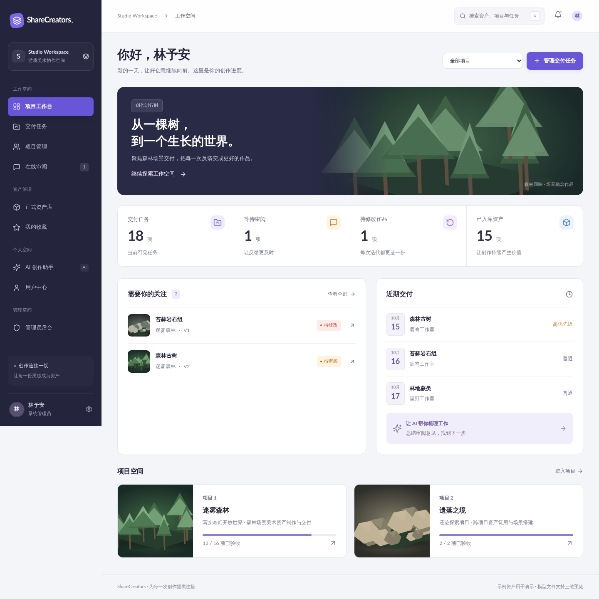
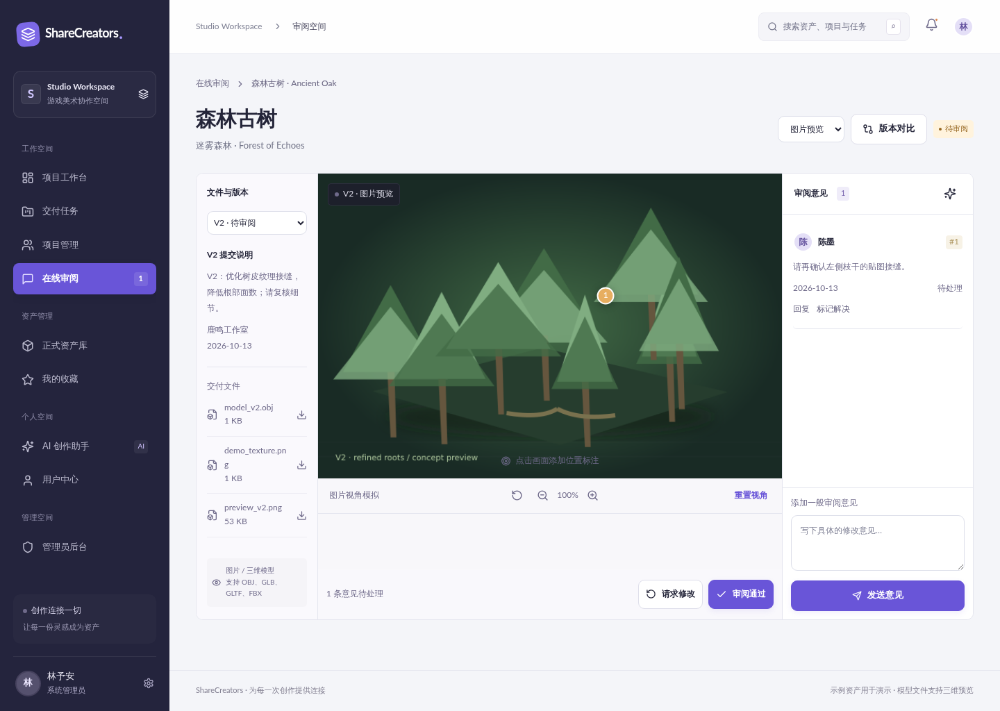
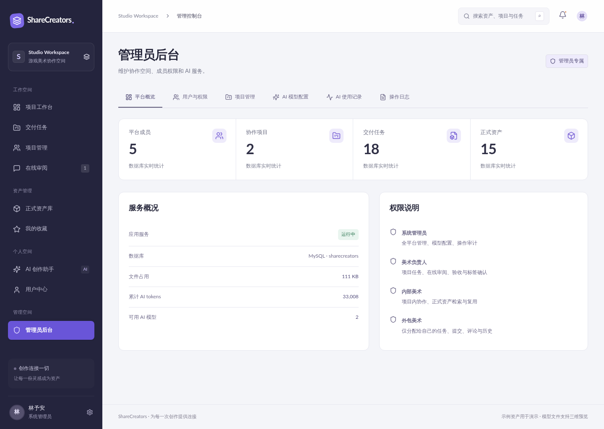

# 创意资产协作工具

创意资产协作工具是面向创意团队的项目、任务和数字资产协作系统，支持素材上传、版本管理、在线审阅、批注、任务流转、团队协同、AI 助手和运营后台。

## 主要功能

- 项目工作台、任务分配、进度和成员协作。
- 图片、视频及设计文件的资产管理、版本记录和元数据。
- 在线预览、批注、审阅、对比和状态确认。
- AI 助手、内容分析和可配置模型服务。
- 用户、团队、权限、用量和运营管理后台。
- 审计记录、数据库备份和业务回归脚本。

## 产品界面







## 技术架构

- Next.js 16、React 19、Node.js 22。
- MySQL、服务端文件存储、Three.js。
- Playwright 自动化测试，Nginx 与 systemd/进程管理器部署。

## 环境要求

- Node.js 22+、npm 10+、MySQL 8.0 或兼容版本。
- 生产环境建议使用 Nginx、HTTPS 和独立非登录系统用户。

## 本地安装

```bash
git clone https://github.com/CharlesYin1204/creative-assets-tool.git
cd creative-assets-tool
npm ci
cp .env.example .env.local
npm run migrate
npm run seed   # 仅在需要初始化内容时执行
npm run dev
```

访问 `http://localhost:3040`。

## 环境变量

| 配置 | 说明 |
| --- | --- |
| `DB_HOST`、`DB_PORT`、`DB_USER`、`DB_PASSWORD`、`DB_NAME` | MySQL 连接 |
| `SESSION_SECRET` | 会话和加密基础，必须使用强随机值 |
| `AI_BASE_URL`、`AI_API_KEY` | 兼容 AI 接口地址和密钥 |
| `AI_DEFAULT_MODEL`、`AI_SECONDARY_MODEL` | 默认及备用模型标识 |

## 构建与验证

```bash
npm run build
npm run test
npm run test:complete
```

测试必须连接隔离数据库，禁止直接指向生产库。生产启动命令为 `npm start`。

## 生产部署

1. 安装 Node.js 22、MySQL 和 Nginx，创建独立数据库与系统用户。
2. 拉取代码并执行 `npm ci`。
3. 创建权限为 `600` 的 `.env.local`，填写数据库、会话和 AI 配置。
4. 执行 `npm run migrate`，按需要执行初始化脚本。
5. 执行 `npm run build`，确认构建和测试通过。
6. 使用 systemd、PM2 或容器运行 `npm start`，监听 `3040`。
7. Nginx 反向代理至 `127.0.0.1:3040`，启用 HTTPS 并设置上传限制。
8. 将素材存储和数据库纳入备份，定期恢复验证。

更新前备份数据库和存储目录，随后拉取代码、执行 `npm ci`、迁移、构建并重启服务。

## 项目结构

- `app/`：页面与 API 路由。
- `components/`：界面组件。
- `lib/`：数据库、鉴权和业务逻辑。
- `scripts/`：迁移、初始化、备份和测试。
- `database/`：数据库结构。
- `docs/screenshots/`：GitHub 产品界面图。

## 常见问题

- 构建失败：确认 Node.js 版本并重新执行 `npm ci`。
- 无法上传素材：检查目录权限、磁盘空间和 Nginx 限制。
- AI 不可用：检查接口地址、模型标识、密钥和服务器网络。
- 页面无数据：确认迁移完成且连接到正确数据库。

## 联系方式

微信：`charlesyin6015`
